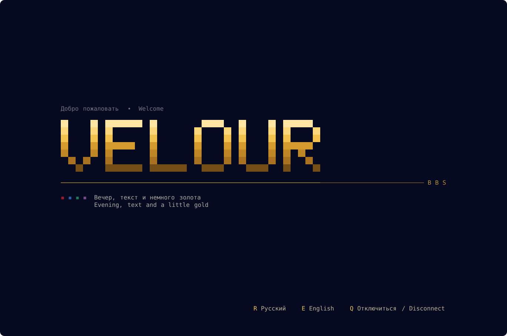

# Velour BBS



Velour is a BBS program. Guests connect by telnet. The sysop writes the screens
as text files and the program shows them in the terminal of the guest.

Velour is written mostly with AI. A human operator controls the work and makes the decisions.
The AI models write the specifications, the code and the guides by the
[development flow](docs/dev-flow/flow.md).

## Features

- Telnet with PuTTY, Tera Term and inetutils telnet in a UTF-8 terminal.
- Detection of the terminal type, the size and the colour depth: 16, 256 or 16 million colours.
- Screens in the BBT format: text, styles, fields and conditions, with forms for narrow and wide terminals.
- A theme for each colour depth.
- Menus with hotkeys. Letters also work in the Russian layout.
- File screens: Markdown, plain text and source code, in pages.
- Import of ANSI art from Moebius, icy_draw and PabloDraw.
- `velourbbs check` and `velourbbs preview`: find the errors and see a screen without a connection.
- Connection limits and the PROXY protocol.

## Quick start

You need Go 1.27.3 or later. Build the program:

```
go build ./cmd/velourbbs
```

The directory `examples/lamp/en/` is a small example BBS. The BBT guide builds it step by step.
Check it, preview its entry screen and serve it:

```
cd examples/lamp/en
../../../velourbbs check
../../../velourbbs preview main --size 80x24
../../../velourbbs serve
```

In another terminal, connect with `telnet localhost 2323`. The terminal needs the UTF-8 charset.

The directory `station/` is the home station of Velour: the BBS of the project, in Russian and English.

## Documentation

- [Setup guide](docs/guide/en/setup/README.md): install, check and run a BBS under systemd.
- [BBT guide](docs/guide/en/bbt/README.md): write the screens. Its example BBS is in [`examples/lamp/`](examples/lamp/).
- The guides in Russian: [setup](docs/guide/ru/setup/README.md), [BBT](docs/guide/ru/bbt/README.md).
- [Brandbook](docs/brand/brandbook.md): the visual system of the home station.
- [Specifications](docs/specs/): the full rules.

## License

[MIT](LICENSE)
